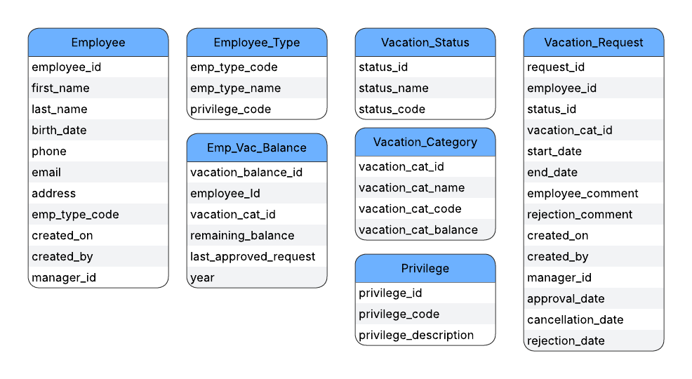
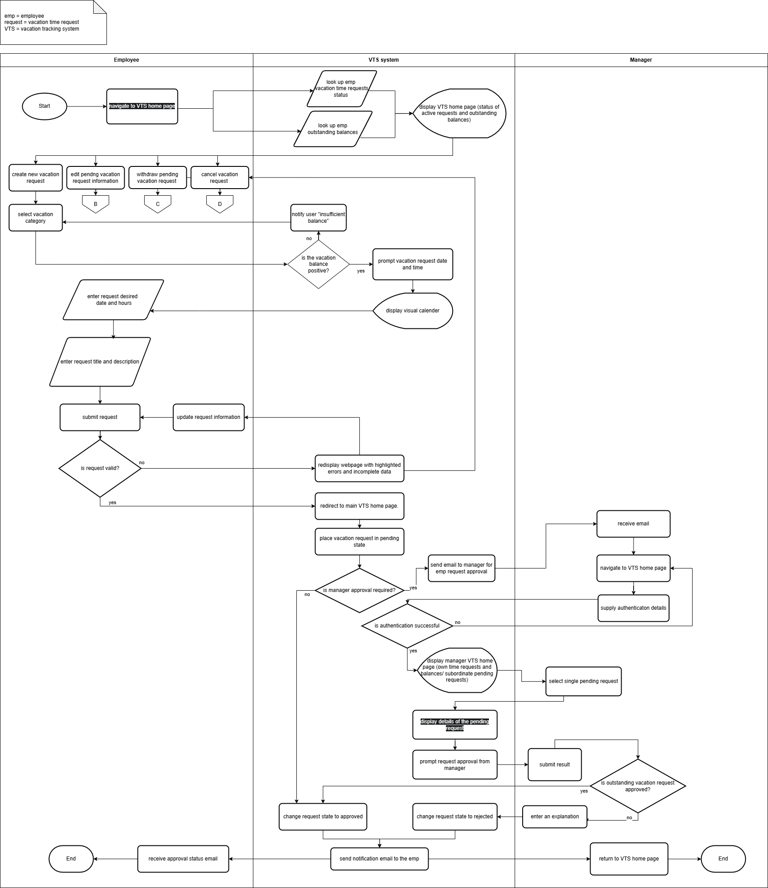
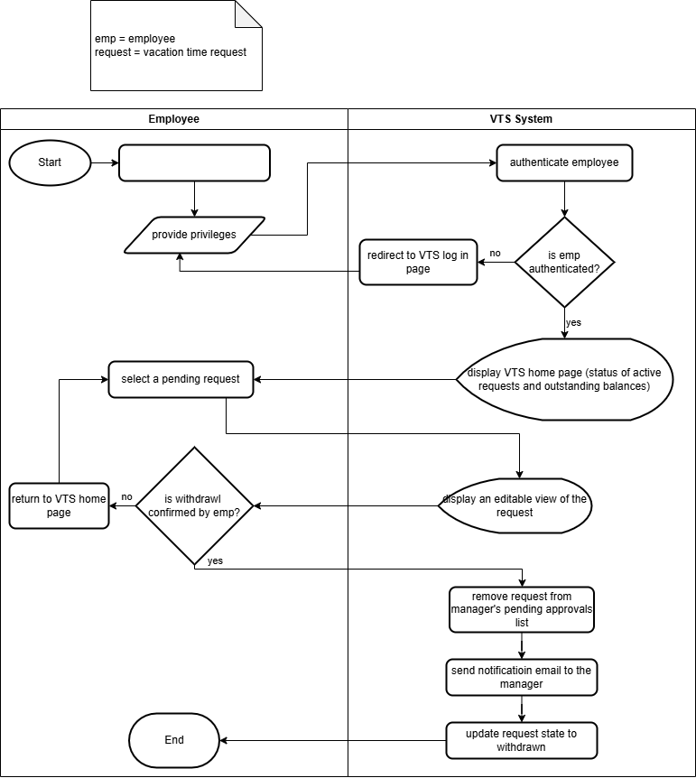
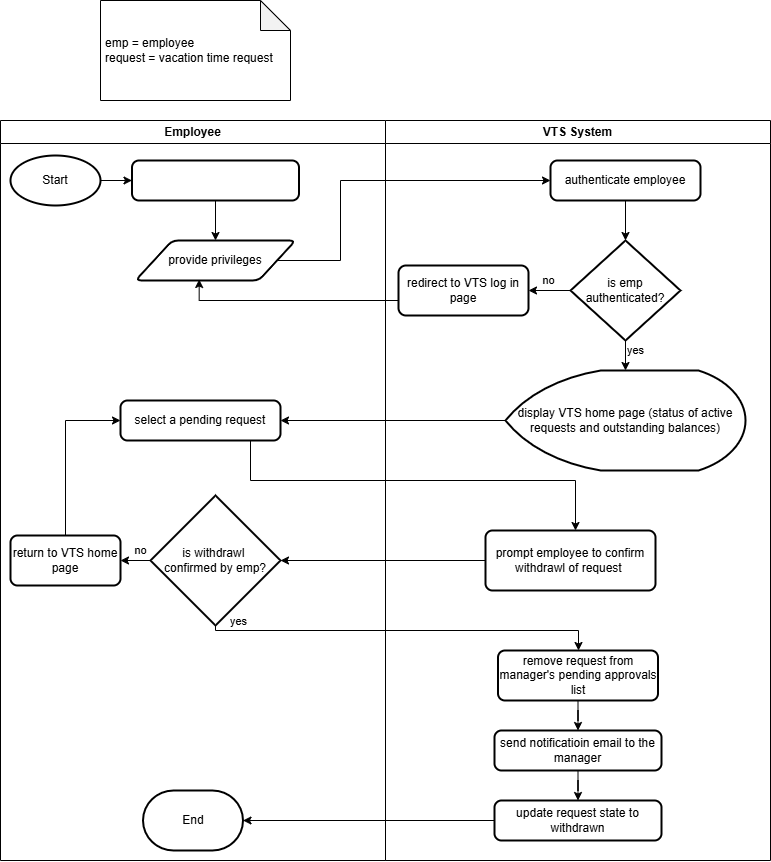
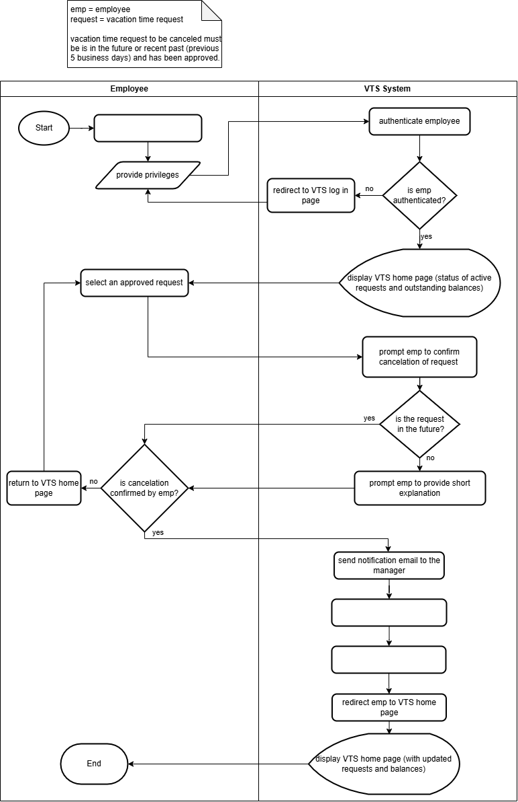
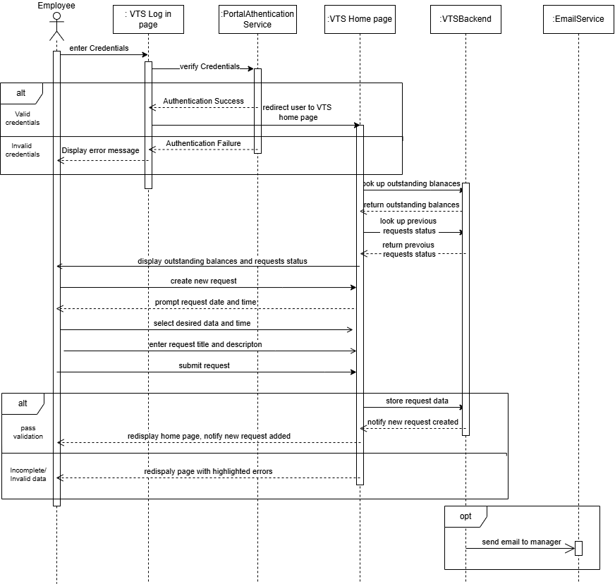
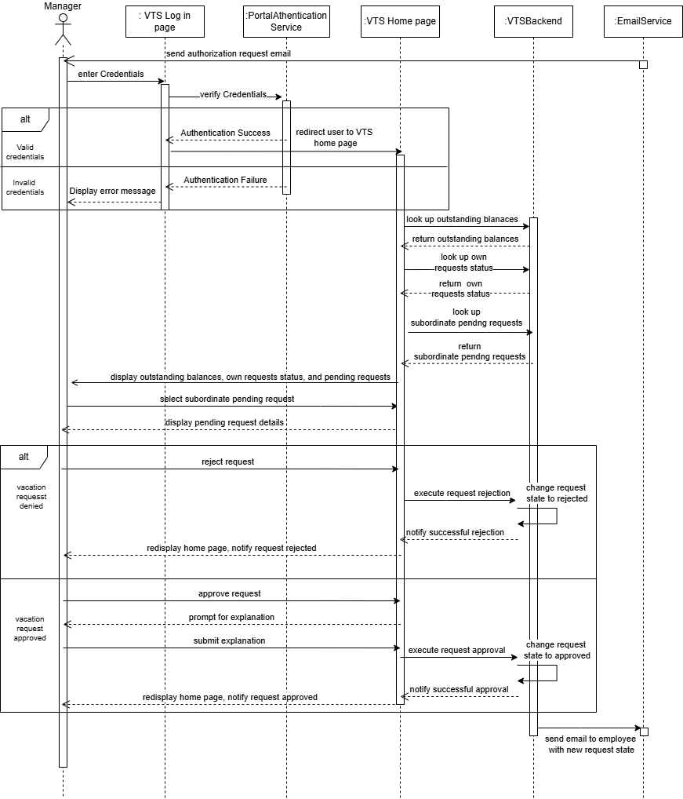
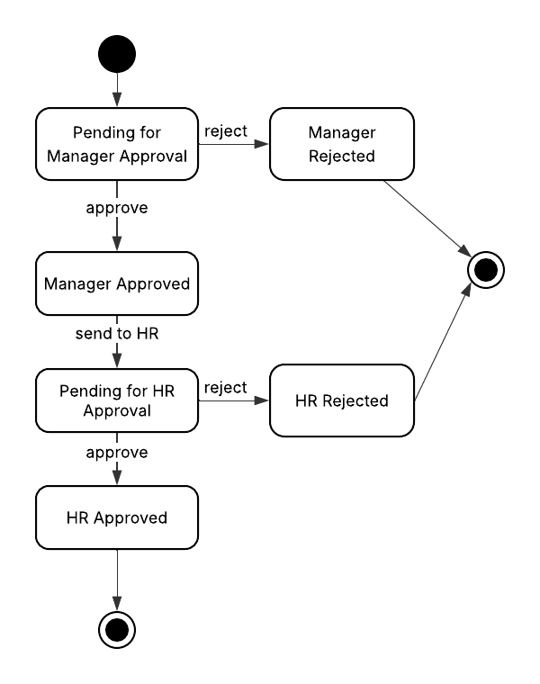

# Software Requirements Specification (SRS)
## Vacation Tracking System (VTS)

| | |
|---|---|
| **Author** | Zeinab Suliman Mohamed Osman |
| **Document version** | 2.0  |

---

## 1. Introduction

### 1.1 Purpose
This document specifies the functional and non-functional requirements of the Vacation Tracking System (VTS). It is intended for developers, business users, or anybody interested in this system.

### 1.2 Project Description
A dynamic Vacation Tracking System designed for organizations with many managers and cross-functional teams. Each employee has exactly one manager, configured in the system, who approves that employee's requests. The system enables employees to manage their leave and time-off requests while providing managers with a centralized view to approve and monitor the leave of their direct reports across multiple projects.

### 1.3 Vision
To improve the organization's internal vacation-management processes and make them faster and more cost-efficient.

### 1.4 Goals
- Let employees manage their own vacation time, sick leave and personal time off without being experts in company policy.
- Let each manager approve or deny requests from their direct reports, while allowing some high-level employees to proceed without approval.
- Remove HR from the burden of requesting and validating each individual request.
- Provide HR with reporting and an authoritative audit trail.
- The system should accommodate for weekends and public holidays.

### 1.5 Scope
**In scope:** management of vacation and all types of time off for employees and managers within a single organization; rules-based validation; approval workflow; notifications; audit logging; HR employee data maintenance; reporting; integration with HR legacy systems and other internal systems.

**Out of scope:** any other aspect of HR (payroll, recruitment, performance, attendance, shift scheduling); payroll calculation of leave pay; multi-organization (multi-tenant) operation.

### 1.6 Definitions and Abbreviations
| Term | Definition |
|---|---|
| VTS | Vacation Tracking System |
| SSO | Single sign-on: users log in through an external identity provider instead of a VTS-specific password |
| IdP | Identity provider: the service that authenticates users. This project uses a mock IdP |
| OIDC | OpenID Connect, the standard protocol VTS uses to authenticate users through an IdP |
| Mock IdP | A lightweight stand-in identity provider with seeded test users, used for development and testing in place of a real organizational IdP |
| Manager | The single person configured in the system as an employee's approver |
| Leave category | A type of time off (e.g. vacation, sick, personal) |
| Balance | Remaining leave entitlement for an employee in a given category |
| Award | Leave granted directly by a manager, without an employee request, by recording specific dates as approved leave (category *Personal*) for an employee who reports to them |
| Override | An action by HR or a System Admin that bypasses a rule |
| Working day | A day on which the employee is scheduled to work, excluding weekends and public holidays. |
| Minimum request length | The smallest number of working days a single request may cover for a category (e.g. at least 1 day, or at least half a day if half-days are supported) |
| Maximum request length | The largest number of consecutive working days a single request may cover for a category (e.g. no more than 15 days at a time), used to prevent very long absences from being approved in one request |
| Minimum notice period | The minimum time between the date a request is submitted and the first day of leave (e.g. 14 days for vacation), so managers can plan. Categories such as sick leave normally have no notice period |
| Blackout period | A date range, set by the System Admin, during which leave of a given category cannot be requested (e.g. the financial year-end close), unless HR or a System Admin overrides it |

### 1.7 References
- Project README (high-level system design diagram)
- Figures 1 to 7 in Section 6 of this document

---

## 2. Overall Description

### 2.1 Domain Problem
Many organizations struggle to track employee vacation time. Managers find it difficult to monitor their subordinates' leave because of limited casual interaction. Employees must be responsible for managing their own time off. HR personnel find it hard to manage every employee's vacation alongside their ongoing responsibilities. Large enterprises often run systems that lack this feature, so VTS must be built with existing systems in mind.

### 2.2 Product Perspective
VTS is a web application that authenticates users through an OpenID Connect identity provider (a mock provider in this project, replaceable by an organization's real provider through configuration), retrieves employee personal data from HR legacy systems, and exposes a web service interface to other internal systems.

### 2.3 Actors and User Classes
| Actor | Description |
|---|---|
| **Employee** | Submits, edits, withdraws and cancels own leave requests; views own balances and history. |
| **Manager** | Approves or denies requests from the employees who report to them (each employee has exactly one manager); views team calendar; awards personal leave within system-set limits. A manager is also an employee and submits own requests. |
| **HR Clerk** | Enters and updates employee vacation data; runs reports; may override rules (logged). |
| **System Admin** | Configures rules, categories, limits and holidays; manages roles; may override rules (logged). |
| **External system** | Internal system consuming the web service interface (non-human actor). |
| **HR legacy system** | Source of employee and organizational data (non-human actor). |

### 2.4 Operating Environment
Web-based, accessed through a standard browser, deployed on existing hardware and middleware within the organization's intranet.

### 2.5 Constraints
1. The system must be web-based and accessible through a web browser.
2. The system must be an extension of any existing HR system, if one exists.
3. The system must authenticate all users through an OpenID Connect (OIDC) identity provider and must not store user passwords. This project uses a mock identity provider.
4. The system must run on existing hardware and middleware.

### 2.6 Assumptions and Dependencies
1. The identity provider (the mock IdP in this project) supplies a stable, unique user identifier that VTS maps to an employee record.
2. The HR legacy system is the source of truth for employee records, reporting lines and employment status.
3. A mail service (SMTP or equivalent) is available for notifications.
4. Public holiday calendars and working-week definitions are maintained in VTS by the System Admin.
5. Leave entitlements are supplied by HR or computed from configured rules.
6. Every employee is assigned exactly one manager in the system (by HR or through the HR import); top-level employees who have no manager are the only exception.

---

## 3. Functional Requirements

Priority: **M** = must have, **S** = should have, **C** = could have.

### 3.1 Leave Request Management (Manage Time)
| ID | Requirement | Pri |
|---|---|---|
| FR-1.1 | The system shall allow an employee to submit a leave request specifying category, start date, end date, title and description. | M |
| FR-1.2 | The system shall calculate the number of requested days (inclusive of start and end date, excluding non-working days) and display it before submission. | M |
| FR-1.3 | Mandatory-field validation shall apply to title and description . | M |
| FR-1.4 | The system shall allow an employee to edit a request while it is pending (Figure 3). | M |
| FR-1.5 | The system shall allow an employee to withdraw a request while it is pending (Figure 4). | M |
| FR-1.6 | The system shall allow an employee to cancel an approved request that has not yet started, and shall restore the balance (Figure 5). | M |
| FR-1.8 | The system shall display each employee's balance per leave category, including available, pending, approved-but-not-taken , approved-but-taken days. | M |
| FR-1.9 | The system shall give each employee access to their requests for the previous calendar year and allow requests up to 18 months in the future. | M |
| FR-1.10 | The system shall allow attachments (e.g. medical certificate) on categories that require them. | C |

### 3.2 Rules-Based Validation
| ID | Requirement | Pri |
|---|---|---|
| FR-2.1 | The system shall validate every request against a configurable rule set before it is accepted. | M |
| FR-2.2 | Rules shall be configurable by the System Admin without code changes where practicable. | S |
| FR-2.3 | The system shall reject a request whose start date is after its end date. | M |
| FR-2.4 | The system shall reject a request whose end date is more than 18 months in the future. | M |
| FR-2.5 | The system shall reject a request that falls outside the permitted past window (see FR-1.9 and Open Issue OI-1). | M |
| FR-2.6 | The system shall reject a request that exceeds the employee's remaining balance in the selected category, taking pending requests into account. | M |
| FR-2.7 | The system shall reject a request that overlaps another pending or approved request of the same employee. | M |
| FR-2.8 | The System Admin shall be able to configure, per leave category, the minimum and maximum request length, the minimum notice period, and blackout periods. The system shall reject any request that violates these settings unless HR or a System Admin overrides it through a logged override (FR-7.1, FR-7.2). | S |
| FR-2.9 | The system shall exclude weekends and configured public holidays from the day count. | M |
| FR-2.10 | The system shall report all failed validations to the user in a single response with a clear reason for each, rather than one at a time. | S |

### 3.3 Approval Workflow
| ID | Requirement | Pri |
|---|---|---|
| FR-3.1 | A valid request from an employee with a manager shall be set to *Pending Approval* and routed to that employee's assigned manager. | M |
| FR-3.2 | A valid request from an employee who does not require approval shall be set to *Approved* automatically and the outcome recorded in the audit log. | M |
| FR-3.3 | The system shall determine which employees do not require approval from configuration (e.g. by role or grade), not solely from the absence of a manager. | M |
| FR-3.4 | Every employee shall be assigned exactly one manager in the system (top-level employees, who have none, are the only exception). A request shall be routed only to that manager, and only that manager (or HR/System Admin through a logged override) may approve or deny it. | M |
| FR-3.5 | The employee's assigned manager shall be able to approve or deny the request, with a comment mandatory on denial. | M |
| FR-3.6 | The system shall deduct the balance when a request is approved and release any reserved balance when a request is denied, withdrawn or cancelled. | M |
| FR-3.7 | The system shall re-validate balance and overlap at the moment of approval. | M |
| FR-3.8 | For exceptional cases where an employee's manager cannot act (e.g. an emergency or absence), the system shall allow the manager, or HR/System Admin on the manager's behalf, to designate one other manager as a temporary delegate for a defined period. During that period the delegate acts in place of the assigned manager (see FR-3.11). | S |
| FR-3.9 | If a request remains pending beyond a configurable period, the system shall remind the approver; if it is still pending after a second configurable period, the system shall notify HR, who may approve or deny it through a logged override. | S |
| FR-3.10 | If a request is pending and the employee's assigned manager changes, the request shall be re-routed to the new manager. | S |
| FR-3.11 | A request shall have exactly one approver at any time, and a single decision (approve or deny) by that approver is sufficient and final. The system shall never require approval from more than one person. If two people with authority over the request (e.g. the assigned manager and a delegate) act at the same time, the first decision shall be saved and the second shall be rejected with a message that the request has already been decided. | M |

**Request states:** Draft (optional), Pending Approval, Approved, Denied, Withdrawn, Cancelled, Completed.

| From | To | Triggered by |
|---|---|---|
| (new) | Pending Approval | Employee submits (approval required) |
| (new) | Approved | Employee submits (approval not required) or manager awards |
| Pending Approval | Approved / Denied | Assigned manager, delegate, or HR/Admin override |
| Pending Approval | Withdrawn | Employee |
| Approved | Cancelled | Employee, manager, or HR/Admin |
| Approved | Completed | System, after the end date |

### 3.4 Manager Features
| ID | Requirement | Pri |
|---|---|---|
| FR-4.1 | The system shall show a manager all pending requests of their direct reporters. | M |
| FR-4.2 | The system shall provide a consolidated calendar of approved and pending leave across the manager's direct reports and their projects. | M |
| FR-4.3 | The system shall highlight team-capacity conflicts (e.g. the number of team members absent on the same day exceeds a configured limit) when a manager reviews a request. | S |
| FR-4.4 | A manager shall be able to award personal leave directly to a subordinate, within system-set limits (maximum days per award and per period, configured by the System Admin). | M |
| FR-4.5 | Awarded leave shall be logged, shall notify the employee, and shall be recorded as an approved leave entry (category *Personal*) for the specific dates the manager chooses, with no approval step. | M |
| FR-4.6 | A manager shall not approve or award leave for themselves. | M |

### 3.5 Notifications
| ID | Requirement | Pri |
|---|---|---|
| FR-5.1 | The system shall email the manager when a request requires approval, including request details and a link to act on it. | M |
| FR-5.2 | The system shall email the employee on every status change (approved, denied, withdrawn, cancelled, awarded). | M |
| FR-5.3 | The system shall email on reminders and escalations (FR-3.9). | S |
| FR-5.4 | Failed email deliveries shall be retried and logged, and shall not block the underlying transaction. | M |
| FR-5.5 | Email templates shall be configurable by the System Admin. | C |

### 3.6 HR Management
| ID | Requirement | Pri |
|---|---|---|
| FR-6.1 | HR personnel shall be able to enter and update employee vacation data (entitlements, balances, carry-over, adjustments). | M |
| FR-6.2 | Manual balance adjustments shall require a reason and shall be logged. | M |
| FR-6.3 | The system shall import employee data and changes (new hires, terminations, transfers, reporting-line changes) from the HR legacy system. | M |
| FR-6.4 | The system shall handle accrual, annual reset and carry-over according to configured rules. | M |
| FR-6.5 | When HR (or the HR import) records an employment end date for an employee, the system shall automatically withdraw all of that employee's pending requests, cancel all approved requests that start after the end date, restore the related balances, and notify the employee's manager and HR. | S |
| FR-6.6 | Approved requests that start on or before the employment end date but finish after it shall be flagged for HR review and shall not be changed automatically. | S |
| FR-6.7 | The system shall calculate a final balance per leave category as of the employment end date (entitlement accrued to that date minus days taken) and make it available to HR in a report. Payment for unused leave is out of scope (handled by payroll). | S |
| FR-6.8 | After the employment end date the former employee shall be denied access and unable to submit requests, but all their requests, balances and audit records shall be retained. | S |
| FR-6.9 | When a manager leaves or is transferred, the system shall alert HR to assign a new manager to each of their direct reports. Until then, those employees' pending requests stay pending and HR may act on them through a logged override. | S |

### 3.7 Administrative Overrides
| ID | Requirement | Pri |
|---|---|---|
| FR-7.1 | HR and System Admin personnel shall be able to override any action restricted by rules (e.g. approve beyond balance). | M |
| FR-7.2 | Every override shall require a written justification and shall be logged with actor, time, rule bypassed and affected record. | M |
| FR-7.3 | Overrides shall be reportable to HR. | S |

### 3.8 Audit Logging
| ID | Requirement | Pri |
|---|---|---|
| FR-8.1 | The system shall log all transactions: request creation, edit, state change, approval decisions, awards, balance changes, overrides, data imports, configuration changes and role changes. | M |
| FR-8.2 | Each entry shall record who, what, when, the previous and new values, and the source (UI, API, import). | M |
| FR-8.3 | Audit logs shall be append-only and not editable or deletable through the application. | M |
| FR-8.4 | Audit logs shall be retained for a configurable period suggested by the organization. | M |
| FR-8.5 | Authorized users (HR, System Admin) shall be able to search and filter the audit log. | S |

### 3.9 Reporting and Statistics
| ID | Requirement | Pri |
|---|---|---|
| FR-9.1 | HR shall be able to view balances and usage by employee, department, project and leave category. | M |
| FR-9.2 | HR shall be able to view pending, approved and denied requests over a period. | M |
| FR-9.3 | HR shall be able to view absence trends, including peak periods, average approval time and override history. | S |
| FR-9.4 | Reports shall be exportable (CSV and PDF). | S |
| FR-9.5 | Report access shall be restricted by role. | M |

### 3.10 Integration and Web Service Interface
| ID | Requirement | Pri |
|---|---|---|
| FR-10.1 | The system shall provide a web service interface for other internal systems to query any given employee's vacation request summary. | M |
| FR-10.2 | The interface shall authenticate callers and authorize them. | M |
| FR-10.3 | The interface shall support retrieval of requests by employee, date range, status and category, and retrieval of updates since a given timestamp. | M |
| FR-10.4 | The interface shall be read-only. | M |
| FR-10.5 | The system shall interface with the HR legacy systems to retrieve employee information and changes, on a scheduled basis and/or on demand. | M |
| FR-10.6 | Import failures shall be logged, shall not corrupt existing data, and shall alert the System Admin. | M |

### 3.11 Authentication and Authorization
| ID | Requirement | Pri |
|---|---|---|
| FR-11.1 | The system shall authenticate all users through an OpenID Connect (OIDC) identity provider and shall not store user passwords. | M |
| FR-11.2 | The system shall enforce role-based access control with strict separation between Employee, Manager, HR and System Admin permissions. | M |
| FR-11.3 | Employees shall see only their own data; managers only the data of their reporting lines; HR and Admin according to role. | M |
| FR-11.4 | A user holding several roles (e.g. manager and employee) shall have the combined permissions with no self-approval. | M |
| FR-11.5 | This project shall include a mock identity provider that implements the OIDC login flow, with seeded test users covering the Employee, Manager, HR Clerk and System Admin roles. It is for development and testing only and shall not be used in production. | M |
| FR-11.6 | The identity provider settings (issuer URL, client ID, client secret) shall be configuration only, so the mock can be replaced by a real provider without code changes. | M |
| FR-11.7 | A user who authenticates successfully but has no active employee record in VTS shall be denied access. | M |
| FR-11.8 | Roles shall be assigned and stored in VTS, not taken from the identity provider. | M |

### 3.12 Permissions Matrix
| Capability | Employee | Manager | HR Clerk | System Admin |
|---|:-:|:-:|:-:|:-:|
| Submit / edit / withdraw / cancel own request | ✔ | ✔ | ✔ | ✔ |
| View own balance and history | ✔ | ✔ | ✔ | ✔ |
| Approve / deny direct reports' requests | | ✔ | | |
| View team calendar | | ✔ | | |
| Award leave (within limits) | | ✔ | | |
| Enter / update vacation data | | | ✔ | |
| Run HR reports | | | ✔ | ✔ |
| Override rules (logged) | | | ✔ | ✔ |
| Configure rules, categories, holidays, limits | | | | ✔ |
| Manage roles and integrations | | | | ✔ |
| View full audit log | | | ✔ | ✔ |

---

## 4. Non-Functional Requirements

| ID | Category | Requirement |
|---|---|---|
| NFR-1 | Usability | A first-time employee shall be able to submit a request without training or reading policy documents; policy guidance shall be shown inline. |
| NFR-2 | Accessibility | The system shall be accessible through current versions of major browsers (Chrome, Edge, Firefox, Safari) and should meet WCAG 2.1 AA. |
| NFR-3 | Security | Authentication shall use OIDC through an identity provider (a mock in this project). All traffic shall use TLS. Access control shall be enforced server-side on every request. The system shall protect against common web vulnerabilities (OWASP Top 10). |
| NFR-4 | Privacy | Personal data and leave reasons (especially sick leave) shall be visible only to authorized roles; managers shall see sick-leave details only to the extent policy allows . The system shall comply with applicable data-protection law. |
| NFR-5 | Interoperability | The system shall communicate with existing legacy systems and expose standard, documented interfaces. |
| NFR-6 | Performance | Typical page loads shall complete in under 3 seconds and request processing in under 2 seconds at expected load. |
| NFR-7 | Scalability | The system shall support the organization's full headcount and concurrent peaks (e.g. year-end) without degradation. |
| NFR-8 | Availability | The system shall be available during business hours with a target of 99.5%. |
| NFR-9 | Reliability and integrity | Balance updates shall be transactional and consistent. Concurrent requests shall not allow the balance to be overspent. Start and end data calculation should be validated against overlapping and rules-related errors. |
| NFR-10 | Backup and recovery | Data shall be backed up daily, with defined recovery point and recovery time objectives. |
| NFR-11 | Maintainability | Rules shall be modular and configurable; the code shall be covered by automated tests, especially the validation logic. |
| NFR-12 | Deployment | The system shall run on existing hardware and middleware. |
| NFR-13 | Localization | Date and time handling shall respect time zones and the organization's working calendar; multi-language support. |
| NFR-14 | Observability | The system shall provide application and error logging and health monitoring. |

---

## 5. Data and Business Rules

### 5.1 Key Business Rules
- **BR-1:** Requested days are calculated as working days between start and end date inclusive.
- **BR-2:** Balance is checked against remaining balance minus days already reserved by pending requests.
- **BR-3:** A request may not overlap another pending or approved request of the same employee.
- **BR-4:** Requests may be made up to 18 months in the future and may be viewed for the previous calendar year.
- **BR-5:** A manager may not approve or award their own leave.
- **BR-6:** Manager awards are capped by system-set limits.
- **BR-7:** Only rule overrides by HR or System Admin may bypass the rules, and each is logged with a justification.
- **BR-8:** Approved leave in the past is immutable except through HR/Admin override.

### 5.2 Data Entities
See Figure 1. At minimum the model covers: Employee, Manager relationship (each employee has exactly one manager), Vacation Category, Vacation Time Balance, Vacation Request, Approval, Award, Holiday, Audit Log, and Notification.

---

## 6. Domain Models

### 6.1 Entity Diagram
#### **Figure 1:** Entity Diagram showing the data model


### 6.2 Flowcharts
#### **Figure 2:** Flowchart A - Manage Time Use Case

#### **Figure 3:** Flowchart B - Edit Pending Request

#### **Figure 4:** Flowchart C - Withdraw Pending Request

#### **Figure 5:** Flowchart D - Cancel Request


### 6.3 Sequence Diagrams
#### **Figure 6:** Sequence Diagram - Manage Time for Employee

#### **Figure 7:** Sequence Diagram - Manage Time for Manager



### 6.4 State Machine Diagram



### 6.5 Pseudocode: Submit Vacation Request

```pseudocode
INPUT req_employee_id, selected_vacation_category

CONNECT TO database "VTSDatabase"

// Employee retrieval
CREATE OBJECT Employee employee
READ FROM Employees WHERE employee_id = req_employee_id INTO employee

// Balance retrieval
READ FROM Vacation_Time_Balance
WHERE employee_id = req_employee_id AND vacation_category_id = selected_vacation_category
INTO remaining_balance_value

SET reserved_days = SUM of requested_days FROM Vacation_Request
    WHERE employee_id = req_employee_id
      AND vacation_category_id = selected_vacation_category
      AND status = "pending_approval"
SET available_balance = remaining_balance_value - reserved_days

IF remaining_balance_value IS NOT NULL AND available_balance > 0 THEN

    INPUT vacation_request_start_date, vacation_request_end_date
    INPUT title, description

    IF validateFrToDates(vacation_request_start_date, vacation_request_end_date) = true AND
       validateTitle(title) = true AND
       validateDescription(description) = true AND
       checkNoOverlap(req_employee_id, vacation_request_start_date, vacation_request_end_date) = true THEN

        // Working days, inclusive, excluding weekends and public holidays
        SET requested_days = CALCULATE_WORKING_DAYS(vacation_request_start_date, vacation_request_end_date)

        IF checkBalanceAvailability(requested_days, available_balance) = true THEN

            BEGIN TRANSACTION

            CREATE OBJECT VacationRequest vacationRequest
            SET vacationRequest.employee_id = req_employee_id
            SET vacationRequest.vacation_category_id = selected_vacation_category
            SET vacationRequest.vacation_request_start_date = vacation_request_start_date
            SET vacationRequest.vacation_request_end_date = vacation_request_end_date
            SET vacationRequest.requested_days = requested_days
            SET vacationRequest.title = title
            SET vacationRequest.description = description

            IF employee.requiresApproval = true AND employee.hasManager = true THEN
                SET vacationRequest.status = "pending_approval"
                SAVE vacationRequest
                WRITE audit_log("REQUEST_SUBMITTED", vacationRequest)
                COMMIT TRANSACTION
                CALL send_email(
                    to = employee.manager_email,
                    subject = "Vacation Request",
                    body = vacationRequest
                )   // failure is retried and logged; it does not roll back the request
                OUTPUT "Request sent to manager for approval"
            ELSE
                SET vacationRequest.status = "approved"
                DEDUCT requested_days FROM Vacation_Time_Balance
                SAVE vacationRequest
                WRITE audit_log("REQUEST_AUTO_APPROVED", vacationRequest)
                COMMIT TRANSACTION
                OUTPUT "No approval required. Request auto-approved."
            END IF

            OUTPUT "Vacation request submitted successfully"

        ELSE
            OUTPUT "Requested days exceed available balance"
        END IF

    ELSE
        OUTPUT "Incomplete or incorrect information"
    END IF

ELSE
    OUTPUT "Insufficient balance"
END IF

DISCONNECT

// Function definitions
FUNCTION checkBalanceAvailability(requested_days, available_balance)
    RETURN requested_days <= available_balance
END FUNCTION

FUNCTION checkNoOverlap(employee_id, start_date, end_date)
    // true when no pending/approved request of this employee intersects the range
    READ FROM Vacation_Request
    WHERE employee_id = employee_id
      AND status IN ("pending_approval", "approved")
      AND start_date <= existing.end_date AND end_date >= existing.start_date
    RETURN (no rows found)
END FUNCTION

FUNCTION validateFrToDates(start_date, end_date)
    IF start_date > end_date THEN
        OUTPUT "End date must be on or after start date"
        RETURN false
    END IF

    SET max_future_date = CURRENT_DATE + 18 MONTHS
    IF end_date > max_future_date THEN
        OUTPUT "Requests cannot exceed 18 months in the future"
        RETURN false
    END IF

    SET min_past_date = <past-window limit, see Open Issue OI-1>
    IF start_date < min_past_date THEN
        OUTPUT "Request date is outside the permitted past window"
        RETURN false
    END IF

    RETURN true
END FUNCTION
```

---
### 6.6 Pseudocode: Approve Vacation Request

```pseudocode


CONNECT TO database "VTSDatabase"
// Function definitions

//Retrieve next request status: to ensure there is a correct request progression across all stages
Function retrieveNextStep (Vacation_Request vacation_request)
  READ FROM Vacation_Status
  WHERE status_id = vacation_request.status_id INTO next_status_sequence
  SET vacation_request.status_id = next_status_sequence
  READ FROM Vacation_Status
  WHERE status_id = next_status_sequence INTO newStatus
  IF newStatus.status_code ="Approved" THEN
    output("Vacation Request successfully approved");
  ELSE
    output("Vacation Request waiting approval: " + newStatus.statusName);
  END IF
  return vacation_request
  // return the vacation request object with the status_id updated
END FUNCTION

DISCONNECT
```

## 7. External Interface Requirements

### 7.1 User Interface
- Role-specific views: employee dashboard (balances, requests, calendar), manager dashboard (pending approvals, team calendar), HR and admin consoles (data entry, reports, configuration, audit log).

### 7.2 Software Interfaces
| Interface | Purpose | Notes |
|---|---|---|
| OIDC identity provider (mock IdP in this project) | Authentication and identity | Mandatory; replaceable through configuration |
| HR legacy system | Employee data, reporting lines, changes | Scheduled and on-demand sync |
| Mail service | Notifications | Retry on failure |
| Internal consumer systems | Query vacation summaries | Via web service interface |

### 7.3 Web Service Interface (minimum contract)
- Retrieve an employee's vacation request summary (balances and requests by status).
- Filter by date range, status and category; retrieve changes since a timestamp.
- Authenticated, authorized per consumer, versioned, , with standard error responses.

---

## 8. Error Handling
- Validation failures return clear, user-readable reasons and do not change state.
- Integration failures (HR sync, email) are logged, retried, and surfaced to the System Admin; they do not corrupt data or block user transactions.
- If a manager is unavailable or has left, the request is delegated, re-routed or escalated (FR-3.8 to FR-3.10).

---

## 9. Acceptance Criteria (examples)
1. An employee with sufficient balance submits a valid request and the manager receives an email within 5 minutes.
2. A request that overlaps an existing approved request is not allowed to be created.
3. Two simultaneous requests that together exceed the balance cannot both be accepted.
4. A denied, withdrawn or cancelled request restores the reserved or deducted balance.
5. An HR override of a blocked request succeeds only with a justification and appears in the audit log.
6. An employee cannot view another employee's requests; a manager cannot view employees outside their reporting lines.
7. The web service returns the same summary the employee sees in the UI.
8. A user who logs in through the mock IdP and has a matching employee record sees only the views and actions permitted for their role.
9. A user who authenticates through the IdP but has no active employee record is denied access.
10. A request is routed only to the submitting employee's assigned manager (or the active delegate); no other manager can see or act on it.
11. If the assigned manager and a delegate try to decide the same request at the same time, only the first decision is saved, the second is rejected, and the request is never left waiting for both.

---

## 10. Risks
| Risk | Mitigation |
|---|---|
| Inaccurate or delayed HR legacy data | Scheduled sync, validation, import alerts, HR manual correction with audit trail |
| Conflicting rules across leave categories | Central configurable rule engine with tests |
| Race conditions on balances | Transactional updates and re-validation on approval |
| Email delivery failures | Retries, in-app visibility of pending items |

---

## 11. Current Implementation Status
The user interface and part of the business logic are not yet complete (see README, Known Issues).

---
By: Zeinab Suliman Mohamed Osman
Last Updated: 02/11/2026 (revised draft)
